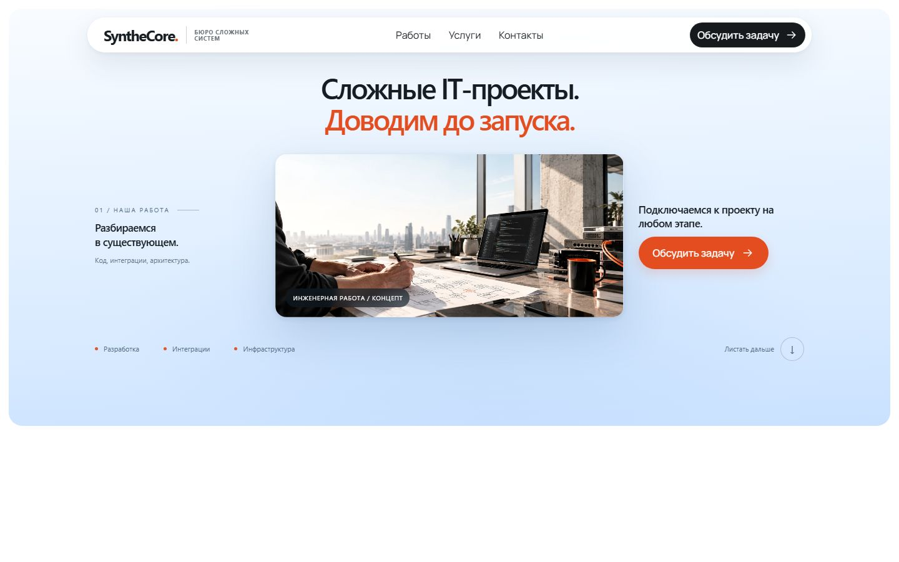
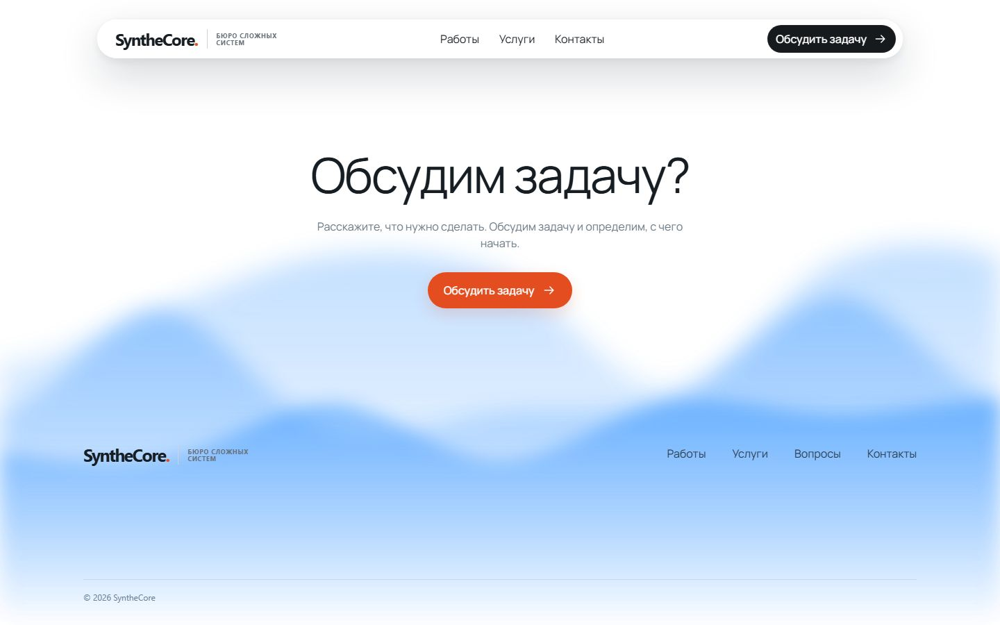
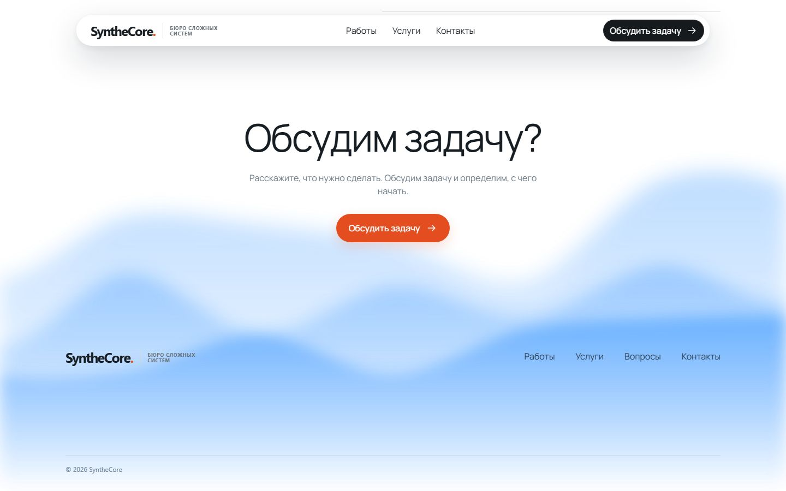
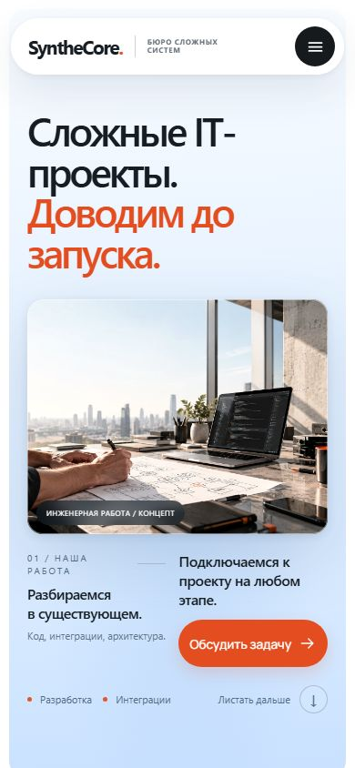
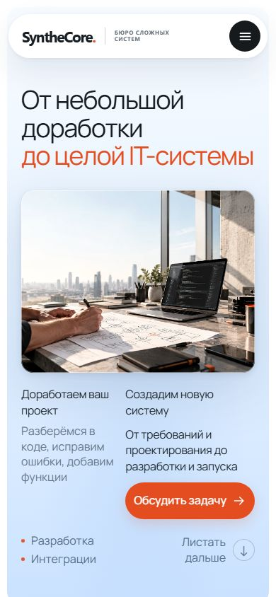

# v62 на правильной основе v27

**Передача в main, 21.10.2026:** владелец разрешил слияние. [PR #6](https://github.com/SigmeD/synthecore_site/pull/6) переводится на `main` и включает историю v27 из PR #4; отдельное промежуточное слияние v27 не требуется. Состав runtime, хедер, футер и их контрольные суммы остаются прежними. [Текущая передача](RELEASE_V62.md). Ниже сохранён протокол первоначальной подготовки PR, когда он ещё был draft с базой v27; его прежние ограничения merge заменены явным разрешением владельца. Разрешение на публикацию не получено.

21.10.2026 владелец уточнил: основой должна быть сборка `output/reference-v27`, интегрированная в **`feat/works-shared-shell-v27`**, а не `main`. Исправленная ветка **`chore/import-approved-v62-on-v27`** создана от точного коммита **`0849711f39f838971bc4e5a732cee0a13ed5917b`**. Рабочие папки и предыдущая ветка импорта сохранены; force push, merge и deploy не выполнялись.

Создан [draft PR #6](https://github.com/SigmeD/synthecore_site/pull/6), base — `feat/works-shared-shell-v27`. [PR #5](https://github.com/SigmeD/synthecore_site/pull/5) закрыт как заменённый, без merge. Импортирующий коммит `09a6da3` имеет прямого родителя `0849711`; [проверка его Git blobs](qa/v62-on-v27/git-commit.json) подтвердила motion/content v62 и сохранённые источники v27. Локальный сервер на 4176 уже обслуживает исправленную главную и `/raboty/`, оба маршрута проверены HTTP 200 и сравнением байтов с диском.

PR #5 был точным импортом архива v62 от main и поэтому не включал общий Header/Footer и каталог v27. Он сохраняется как история первоначального импорта и заменяется исправленной интеграцией. Новый PR направляется в `feat/works-shared-shell-v27`, чтобы показывать изменения относительно выбранной владельцем основы; сама основа пока также ожидает отдельного merge через PR #4.

## Что откуда взято

| Источник | Сохранённое содержимое |
|---|---|
| v27, `0849711` | Общие partials хедера/футера, Header v24, Footer v12, их исходные стили, `footer-waves.js`, `footer-reveal.js`, локальные шрифты, `/raboty/` и код каталога, build-time шаблоны и сервер с directory index |
| Утверждённый ZIP v62 | Все семь содержательных секций главной, 17 защищённых CSS/JS, надстройки типографики, sticky-сцены, единый Lenis/GSAP, первая и последующие карточки работ, выравнивание услуг и +30% отзывов |
| Интеграция | Только композиция главного шаблона, `css/v62-v27-shell-preservation.css`, проверки и документация |

**Все 17 защищённых файлов v62 совпадают байт-в-байт.** Не менялись их настройки движения, очередь refresh, sticky, длительности или алгоритмы. Полный фрагмент `<main>` до футера совпадает с v62: семь секций не переписывались. SHA исходников зафиксированы в [V62_ON_V27_SOURCES.json](V62_ON_V27_SOURCES.json).

Все 25 файлов контракта оболочки/каталога v27 проверяются отдельно: текст сравнивается с нормализованными LF, бинарные шрифты — по исходным байтам. Partials, исходные shell CSS/JS и каталог не перерабатывались. Сгенерированные `/` и `/raboty/` проверены на соответствие единым шаблонам.

Глобальные правила `design-system-v61.css` и типографики v62 переопределяли ширину хедера, подпись логотипа, наследуемые шрифты и часть текста футера. Исправление находится в отдельном CSS с селекторами только `#floatingHeader` и `#contact`: он восстанавливает значения v27. Исходные CSS v27 и защищённые файлы v62 остаются целыми. Отдельных изменений волн/reveal нет.

На главной меню уже находится в неизменяемом `main.js` v62, поэтому там не подключается второй `site-header.js`. Каталог сохраняет собственное прежнее подключение `site-header.js`. Legacy-ветка footer-кода из защищённого `faq-footer.js` не имеет `.sc-footer__wave`-узлов в новой разметке; реальные три слоя `.rwb-layer` обслуживает только исходный v27 wave engine. Это проверено поведением меню, числом слоёв и активностью волн.

## Результаты проверок

Материалы: [docs/qa/v62-on-v27](qa/v62-on-v27), [статический лог](qa/v62-on-v27/static-checks.txt).

- `node scripts/verify-v62-import.cjs`: **17/17**.
- `node scripts/build-site.cjs --check`: обе сгенерированные страницы актуальны.
- `node --test scripts/test-static-checks.cjs scripts/test-shared-site.cjs`: **75/75**. Включены отдельные проверки 17 motion SHA, 25 файлов v27 и исходной разметки семи секций.
- `check-project`, `verify-works-static`, `verify-services-static`, `check-hero-geometry`, `verify-sticky-handoff-v61`: PASS. HTTP-проверка — **58 ресурсов** совпали с файлами.
- [Движение v62](qa/v62-on-v27/motion-report.json): **372/372** на 320×568, 390×844, 768×1024, 1024×768, 1440×900 и 1920×1080. Первая карточка растёт 0,885 → 0,9425 → 1, шесть работ проходят в обе стороны, услуги имеют CSS sticky / `overflow: clip` / нулевой `scrollLeft`, последняя услуга достижима. Проверены отзывы +30%, быстрый/обратный wheel, исходный DevTools trace, touch swipe, FAQ, resize и reduced motion. Ошибок консоли/ресурсов нет. Геометрия и состояния движения в трёх контрольных точках совпали с отдельно запущенным архивом на 390 и 1440 px.
- [Оболочка против v27](qa/v62-on-v27/shell-report.json): **0 отличий выбранных computed-style метрик** для 25 селекторов хедера/футера на всех шести размерах. Это проверка выбранных свойств, а не заявление о побайтовом совпадении полного HTML двух сборок. Волны используют случайные фазы, поэтому пиксельный снимок водной поверхности не должен быть идентичным.
- [Оболочка и каталог](qa/v62-on-v27/catalog-report.json): **295/295** на обеих страницах, включая 320, 390, 990, 1440, 1920 и 2560 px. Проверены меню/Escape/возврат фокуса, маршруты, карточки и диалоги, типографика, отсутствие переполнения, три волны, их остановка вне футера и reduced motion, reveal CTA и один Lenis.

Визуально просмотрены десктопный и мобильный хедер и футер. [Видео 1440×900, 68,16 с](qa/v62-on-v27/1440x900/scroll-and-checks.webm) декодируется, проверены переходы к четырём кадрам; [метаданные](qa/v62-on-v27/1440x900/video-check.json). Нужна ручная оценка физической мышью/тачпадом: автоматический ввод и контрольные кадры не заменяют просмотр непрерывного движения на устройстве. Другие браузеры и реальные мобильные устройства в этом прогоне не проверялись.

| Исходная v27 | Исправленная v62 на v27 |
|---|---|
|  |  |
|  |  |
|  |  |

## Почему full strict не проходит

Полный manifest архива описывает самостоятельную v62 с другой оболочкой. После прямого уточнения владельца это не целевое финальное дерево.

В локальной рабочей папке этого прогона `node scripts/verify-v62-import.cjs --strict` показывает **423/437**, завершение — с кодом 1. [Полный вывод](qa/v62-on-v27/strict-check.txt), [перечень исключений](qa/v62-on-v27/strict-exceptions.json). Проверка не переименована в PASS и manifest не изменён. Число побайтовых совпадений исторических текстовых файлов зависит также от CRLF checkout; контракт целевого коммита проверяется отдельно по 17 raw motion SHA, 25 файлам v27 и содержимому семи секций.

13 отличающихся файлов: `.gitattributes`, `README.md`, четыре документа состояния, `index.html`, `scripts/HISTORICAL_CHECKS.md`, четыре инфраструктурных/проверочных скрипта и `start-local.ps1` (точный список в JSON). Это сохранённая инфраструктура/документация v27, обновлённые сведения или композиция оболочки, а не изменения защищённых motion-файлов. Декоративный `Screenshot_1.png` из корня архива не добавлялся в релизные исходники. Отдельное разрешение на использование v27 как основы — сообщение владельца, которым исправлена задача после PR #5.

## Запуск и повторение

Из основной папки: `node scripts/build-site.cjs`, затем `./start-local.ps1 -Port 4176 -NoBrowser`. Адреса: `http://127.0.0.1:4176/` и `/raboty/`.

Для повторения сравнительной QA исходная v27 доступна в `output/worktrees/works-v27`, ZIP v62 распакован в `output/v62-source`. `node docs/qa/v62-on-v27/serve.cjs` запускает loopback-серверы 4180 (v27), 4181 (текущая сборка), 4182 (архив). Сценарии `shell.cjs`, `motion.cjs`, `catalog.cjs` в той же папке записывают результаты в `output/v62-on-v27`.

После staging/commit проверяйте Git blobs: `node docs/qa/v62-on-v27/verify-git.cjs` или с аргументом `HEAD`. Для 17 защищённых файлов staging выполняется с `core.autocrlf=false`, чтобы Git не переписал исходные CRLF. Сам проект не требует установки новых зависимостей для просмотра; Playwright нужен только для браузерной QA.
