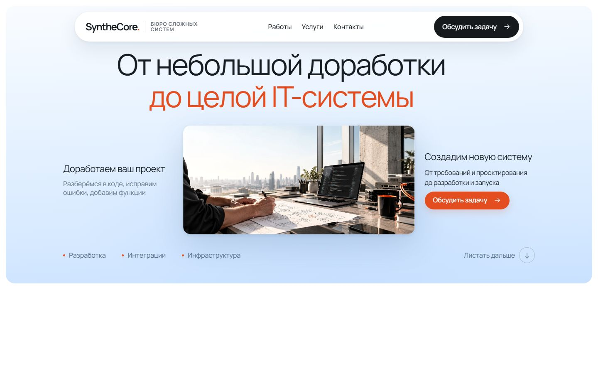
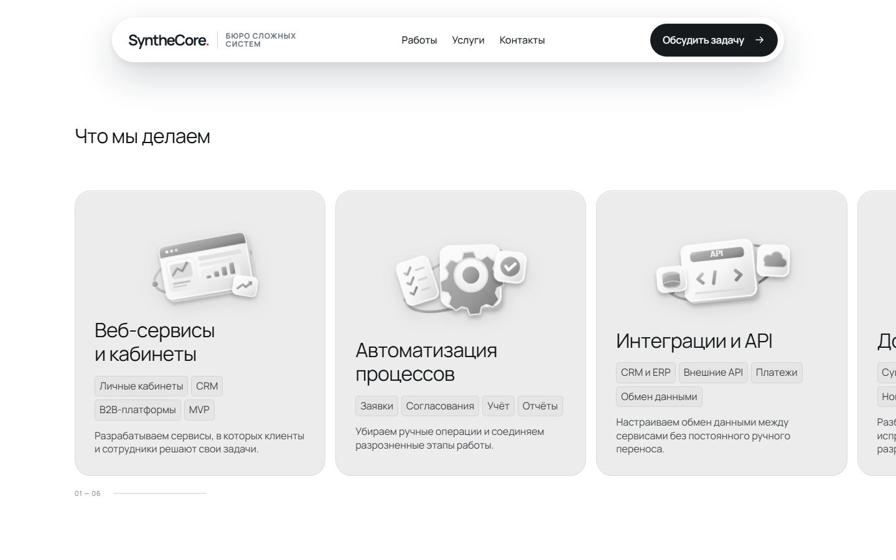
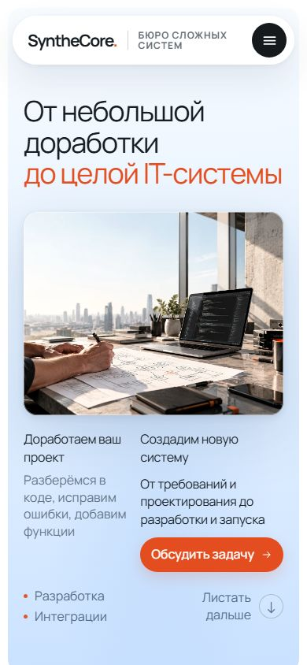

# Проверка точного импорта SyntheCore v62

Дата: 21.10.2026. Ветка: `chore/import-approved-v62`, создана от текущего `main` — `67f75cda3a7398be7c3d7955cc2706db71f0ae6a`. Перед импортом рабочая папка была чистой; удалённый `main` совпадал с этим коммитом. Существующие worktree не изменялись.

Старая анимационная реализация Git заменена утверждённой v62 из приложенного архива. Сами файлы v62 не изменялись; контрольные суммы совпадают.

## Источник и целостность

Архив: `D:\downloads\SyntheCore_v62_Git_Agent_Handoff_v2.zip`.

SHA-256 архива: `2169bdac56210c3d5f4874b1147be0b2bf6958f14af941d175589502be9e7b0a`.

- Импортированы все **445** переданных файлов, без преобразований.
- `node scripts/verify-v62-import.cjs --strict`: **437/437** исходных файлов совпали.
- `node scripts/verify-v62-import.cjs`: **17/17** защищённых motion-файлов совпали.
- Дополнительно все **445/445** файлов проверены непосредственно против ZIP независимым ревью и против Git blobs после staging. См. [проверку индекса](git-index-bytes.json).
- SHA-256 полного `index.html`: `dcb5c0f7ffa97fc05f51ce5090a4809cf1b7414cf2b4a0e231daaa4af1b29350`. Вместе с ним неизменны разметка хедера/футера, порядок подключений CSS/JS и их каскад из архива. Самостоятельных изменений поверх v62 нет.
- Сохранены 72 ранее отслеживаемых исторических файла вне архива: `backup/` и два reference-файла в `output/`. Они не подключены в текущую страницу и не изменены. ZIP и автономная HTML-демонстрация в Git не добавлялись.

Перед импортом файловое сравнение рабочей папки выявило 404 совпадающих файла, 9 изменённых и 32 новых. Полный перечень с SHA до/после — [comparison.json](comparison.json). Все 36 ассетов, включая локальные библиотеки GSAP/ScrollTrigger 3.12.5 и Lenis 1.3.26, уже совпадали с ZIP; они проверены и перенесены без обновления версий.

**Переводы строк:** у 115 файлов, уже совпадавших с ZIP в рабочей папке, старые Git blobs содержали LF вместо эталонного CRLF. Поэтому коммит включает изменения переводов строк, в том числе исторической документации, части CSS/JS и проверочных скриптов. Содержимое не перерабатывалось: сохранены именно байты архива. Staging выполнен через `git -c core.autocrlf=false add`, затем `add --renormalize` только по 445 путям архива. `.gitattributes` также взят без правок из ZIP.

Для воспроизведения строгой SHA-проверки используйте чистый checkout с `core.autocrlf=false`, например `git -c core.autocrlf=false clone <repository> <new-directory>`. Иначе преобразование CRLF при checkout может нарушить байтовое совпадение. Git-объекты проверены отдельно и содержат точный эталон.

## Что заменено относительно main

| Область | Подтверждённая разница импорта |
|---|---|
| Прокрутка | Единый Lenis с `lerp: 0.068`, ticker GSAP и общей очередью refresh; удалены прежние покадровые принудительные сбросы |
| Hero | CSS sticky вместо GSAP pin; `revealPortion: 1`, раскрытие картинки по всему диапазону |
| Работы | CSS sticky, новая входная анимация первой карточки и согласованное масштабирование следующих пяти |
| Услуги | CSS sticky, общий владелец вертикальной прокрутки, пересчёт геометрии, `overflow: clip`, выравнивание первой карточки |
| Отзывы | `410svh → 533svh`, `2900px → 3770px`, то есть +30%; согласованное сглаживание `0.18` |
| Шаги и FAQ | Точная версия из ZIP: расчёт по числу шагов, FAQ использует общую очередь refresh |
| Контент | Точная разметка v62, Manrope и утверждённые тексты; маркировка четырёх отзывов `ДЕМО` сохранена |

## Статические и HTTP-проверки

Все команды завершились с кодом 0. [Полный вывод](static-checks.txt).

| Команда | Результат |
|---|---|
| `node scripts/check-project.cjs` | PASS |
| `node scripts/verify-works-static.cjs` | PASS, шесть карточек и их исходные изображения |
| `node scripts/verify-services-static.cjs` | PASS, шесть услуг |
| `node scripts/check-hero-geometry.cjs` | PASS, 12 сочетаний, 60 состояний кадрирования |
| `node --test scripts/test-static-checks.cjs` | **69/69** |
| `node scripts/verify-sticky-handoff-v61.cjs` | PASS, CSS sticky и +30% отзывов |
| `node scripts/check-project.cjs --http http://127.0.0.1:4176/` | PASS, 51 HTTP-ресурс совпал с файлами |

В старых скриптах сохранены исторические подписи `v60`/`experimental`. Их не редактировали ради переименования; версию импорта устанавливает SHA manifest v62.

## Браузерная проверка

Chromium **149.0.7827.55**, DPR 1. [Полный отчёт](browser-report.json). Все **372/372** проверки прошли; в каждом основном прогоне нет ошибок JavaScript/консоли, HTTP-ошибок или неудачных загрузок ресурсов. Manrope загружен из предусмотренного эталоном Google Fonts. Ни один тест не изменял исходники сайта.

| Размер | Проверки | Особенности |
|---|---|---|
| 320×568 | 58/58 | Нативный touch swipe услуг, мобильное меню |
| 390×844 | 59/59 | Touch swipe и прямое сравнение с архивом |
| 768×1024 | 58/58 | Планшет, нативная горизонталь |
| 1024×768 | 57/57 | Sticky-услуги, нативные отзывы |
| 1440×900 | 80/80 | Все сцены, wheel вперёд/назад, trace, видео, сравнение с архивом |
| 1920×1080 | 60/60 | Все десктопные сцены, включая увеличенную дистанцию отзывов |

На каждом размере проверены шесть работ вперёд и назад, доступность услуг, FAQ с клавиатурой, отсутствие горизонтального переполнения страницы, последовательные resize через 1440/768/390/1024 px и обратно, уникальность trigger IDs, один живой Lenis, отсутствие GSAP pin-spacer. Reduced motion отключает Lenis и ScrollTrigger-сцены, переводит галереи в упрощённый режим и останавливает волны футера; возврат настройки восстанавливает один Lenis.

Наблюдения на 1440×900:

- Hero: масштаб изображения **0,3951 → 0,6975 → 1**, маска раскрывается до `inset(0px ...)`; прогресс 0/0,5/1. Проверялся вложенный `img`, поскольку внешний контейнер сохраняет размер сцены.
- Первая работа: масштаб **0,885 → 0,9425 → 1**. Все следующие карточки достигают масштаба 1 на своей стадии; обратный проход воспроизводит те же состояния.
- Услуги: заголовок и первая карточка начинаются на **x=120 px**; первая карточка целиком видна, `overflow-x: clip`, `scrollLeft=0` в начале и конце. Последняя карточка доступна полностью.
- Отзывы: высота сцены **4797 px = 533svh**; на 1920×1080 — **5756,39 px** с округлением CSS. Четвёртая карточка остаётся видимой при выходе; карточки непрозрачны, GSAP pin отсутствует.
- Медленное колесо пересекало пять границ: 990, 2427, 6567, 7095 и 8498 px, затем возвращалось. Максимальное смещение за записанный кадр в этих отдельных прогонах — **8, 8, 12, 9 и 10 px**; возврат в пределах 1 px. Быстрые wheel-импульсы по 1600 px достигли футера и вернули страницу наверх.
- Использован исходный `QA/DEVTOOLS_STICKY_TRACE.js`. [Полный trace](1440x900/sticky-trace.json) включает также намеренные мгновенные переходы теста между сценариями: их нельзя трактовать как рывки wheel-прокрутки. Изолированные wheel-диапазоны и их метрики сохранены в отчёте.
- Отдельные HTTP-копии ZIP и импорта дали одинаковые геометрию и motion-состояния в трёх точках на 1440×900 и 390×844; для них сохранены парные скриншоты `compare-archive-*` / `compare-import-*`.

Скриншоты визуально просмотрены: Hero на десктопе/мобильном, первая и последующие работы, старт услуг, середина отзывов и контрольные кадры видео. Подтверждено соответствие зафиксированным состояниям эталона; исходники после импорта не менялись.

## Материалы для просмотра

| Архив | Импорт |
|---|---|
|  |  |
|  |  |
|  |  |

[Видео 1440×900, 64,36 секунды](1440x900/scroll-and-checks.webm) содержит контрольные стадии, медленные проходы границ, быструю прокрутку вниз/вверх и reduced motion. Воспроизведение проверено в Chromium; проверены декодирование и переходы на 12,872 / 25,744 / 38,616 / 51,488 секунды. [Метаданные](1440x900/video-check.json), кадры `video-frame-*.jpg` лежат рядом.

**Осталось ручное ревью физической мышью/тачпадом.** Автоматические wheel/touch события Chromium и отдельные просмотренные кадры не доказывают субъективную плавность на реальном устройстве. Полное непрерывное видео человеком не просмотрено; Firefox, Safari/WebKit и физические мобильные устройства в этом прогоне не проверялись. Эти ограничения не устранялись изменением утверждённого кода. PR готовится как draft для ручного ревью; merge и публикация не выполняются.

## Повторение проверок

Из корня проекта распакуйте исходный архив в `output/v62-source`, затем запустите в отдельном терминале `node docs/qa/v62/serve.cjs`. Он обслуживает импорт на 4176 и архив на 4177, только на loopback. Запуск браузерной матрицы: `node docs/qa/v62/audit.cjs`; потребуется установленный Playwright и Chromium. Все результаты нового прогона пишутся в `output/playwright/v62/results`. Для одного размера: `--only=1440x900`.

Прямая проверка Git blobs после staging/commit: `node docs/qa/v62/verify-git-bytes.cjs` или `node docs/qa/v62/verify-git-bytes.cjs HEAD`. Она использует `comparison.json` рядом со скриптом, исходную распаковку в `output/v62-source` и сохраняет результат в `output/v62-migration`. Для смыслового просмотра diff без шума переводов строк используйте `git diff --ignore-space-at-eol main...HEAD`.
